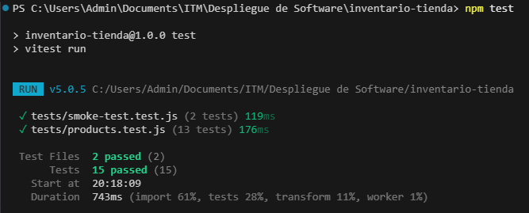
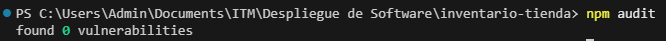
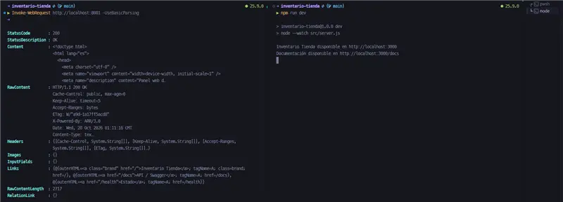
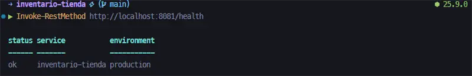
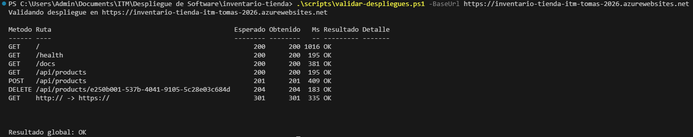

# Inventario Tienda

Aplicación web para consultar y administrar el inventario de una tienda. Fue desarrollada con Node.js y Express y publicada en dos entornos: IIS como despliegue local *on-premises* y Azure App Service como despliegue público en la nube.

El proyecto corresponde a la Práctica 3 de Despliegue de Software del Instituto Tecnológico Metropolitano. Incluye panel web responsive, API REST, documentación OpenAPI, comprobación de salud, pruebas automatizadas, scripts reproducibles y evidencias de funcionamiento.

## Enlaces de la entrega

| Recurso | Enlace |
|---|---|
| Aplicación en Azure | [https://inventario-tienda-itm-tomas-2026.azurewebsites.net](https://inventario-tienda-itm-tomas-2026.azurewebsites.net) |
| Health check público | [https://inventario-tienda-itm-tomas-2026.azurewebsites.net/health](https://inventario-tienda-itm-tomas-2026.azurewebsites.net/health) |
| Swagger público | [https://inventario-tienda-itm-tomas-2026.azurewebsites.net/docs](https://inventario-tienda-itm-tomas-2026.azurewebsites.net/docs) |
| Repositorio | [https://github.com/tomasgonzalez0/inventario-tienda](https://github.com/tomasgonzalez0/inventario-tienda) |
| Video de evidencia | **Carolina debe reemplazar este texto por la URL pública de YouTube antes de publicar el README.** |

El repositorio se encuentra compartido con el docente mediante el usuario de GitHub `oalarconpe`.

## Integrantes y responsabilidades

| Integrante | Responsabilidad | Contribución verificable |
|---|---|---|
| **Tomás González Zapata** | Coordinación, aplicación y repositorio | Creación de la base web, panel de inventario, API, automatización inicial de Azure e integración de mejoras. |
| **Daniel Felipe Marín Marín** | Publicación en IIS | Proxy inverso, Application Pool, sitio, binding, scripts de configuración y evidencias de validación local. |
| **Carla Juliana Giraldo Camacho** | Azure App Service | Validación del App Service, revisión de la integración y consolidación de las evidencias de Azure. |
| **Samuel Cristóbal Cuello Duque** | Pruebas y calidad | Pruebas automatizadas, smoke tests multientorno, auditoría de dependencias y evidencias de validación. |
| **Carolina Arango Escobar** | Documentación y entrega | README final, organización de evidencias, documento académico, video y verificación de enlaces. |

Cada integrante debe conservar al menos un commit o Pull Request significativo asociado con su responsabilidad. Los aportes ya fusionados pueden consultarse en el historial y en la sección de Pull Requests del repositorio.

## Estado verificado

| Componente | Resultado |
|---|---|
| Aplicación Node.js local | Operativa |
| Publicación mediante IIS | Operativa en `http://localhost:8081` |
| Azure App Service | `Running` |
| HTTPS Only | Habilitado |
| Health check en IIS | HTTP 200, estado `ok` |
| Health check en Azure | HTTP 200, estado `ok` |
| Redirección HTTP a HTTPS | HTTP 301 |
| Pruebas automatizadas | 15 aprobadas |
| Auditoría de dependencias | 0 vulnerabilidades |

Fechas de publicación:

- IIS: **27 de octubre de 2026**.
- Azure App Service: **27 de octubre de 2026**.

## Funcionalidad

- Panel web responsive con resumen del inventario.
- Consulta del catálogo de productos.
- API REST para crear, consultar, actualizar y eliminar productos.
- Validación de datos con Zod.
- Documentación interactiva mediante Swagger UI.
- Endpoint `/health` para comprobar disponibilidad y entorno.
- Endpoint `/api/info` con información pública del servicio.
- Manejo coherente de estados HTTP y errores JSON.
- Pruebas unitarias, de integración y smoke tests.
- Scripts reproducibles para IIS y Azure App Service.

> Los datos se almacenan en memoria. Se reinician cuando se reinicia el proceso o la instancia de la aplicación; esta decisión corresponde al alcance académico de la práctica.

## Arquitectura

```text
                                      ┌──────────────────────────────┐
Navegador ── HTTP :8081 ──► IIS/ARR ─►│ Node.js/Express :3001       │
                                      │                              │
Navegador ── HTTPS ──────────────────►│ Azure App Service           │
                                      │                              │
                                      │ Panel web + API + Swagger   │
                                      └──────────────────────────────┘
```

IIS utiliza URL Rewrite y Application Request Routing para reenviar las solicitudes recibidas en el puerto `8081` al backend Node.js enlazado únicamente a `127.0.0.1:3001`. Azure ejecuta la misma aplicación sobre Linux con Node.js 24 LTS.

## Tecnologías

- Node.js 22 o superior.
- Express 5.
- HTML5, CSS y JavaScript.
- OpenAPI 3.0 y Swagger UI.
- Zod para validación.
- Vitest y Supertest.
- PowerShell 5.1 o superior.
- IIS, URL Rewrite y Application Request Routing.
- Azure CLI y Azure App Service para Linux.

## Requisitos

### Desarrollo local

- Node.js 22 o superior.
- npm.
- Git.

### IIS

- Windows 11.
- PowerShell ejecutado como administrador.
- Permiso para habilitar características de Windows e instalar componentes firmados de Microsoft.

### Azure

- Azure CLI.
- Suscripción con permiso para crear o actualizar un App Service.
- Sesión iniciada mediante `az login`.

No se deben copiar contraseñas, tokens o códigos de autenticación en archivos del repositorio.

## Instalación y ejecución local

```powershell
git clone https://github.com/tomasgonzalez0/inventario-tienda.git
cd inventario-tienda
npm ci
npm test
npm start
```

Servicios locales:

- Panel: [http://localhost:3000](http://localhost:3000)
- Swagger: [http://localhost:3000/docs](http://localhost:3000/docs)
- Health check: [http://localhost:3000/health](http://localhost:3000/health)

Variables de entorno admitidas:

| Variable | Valor predeterminado | Uso |
|---|---|---|
| `PORT` | `3000` | Puerto de escucha de Node.js. |
| `HOST` | `0.0.0.0` | Interfaz de red. En IIS se usa `127.0.0.1`. |
| `NODE_ENV` | `development` | Entorno de ejecución. |
| `APP_NAME` | `Inventario Tienda` | Nombre público de la aplicación. |

## API REST

| Método | Ruta | Descripción | Respuesta principal |
|---|---|---|---|
| GET | `/` | Panel web del inventario | HTML, 200 |
| GET | `/health` | Estado del servicio | JSON, 200 |
| GET | `/api/info` | Información pública de la aplicación | JSON, 200 |
| GET | `/docs` | Swagger UI | HTML, 200 |
| GET | `/openapi.yaml` | Especificación OpenAPI | YAML, 200 |
| GET | `/api/products` | Lista productos | JSON, 200 |
| GET | `/api/products/:id` | Consulta un producto | JSON, 200 o 404 |
| POST | `/api/products` | Crea un producto | JSON, 201 |
| PUT | `/api/products/:id` | Reemplaza un producto | JSON, 200 |
| DELETE | `/api/products/:id` | Elimina un producto | 204 |

El recurso producto contiene `id`, `sku`, `name`, `description`, `price` y `stock`.

## Publicación en IIS

La implementación utiliza:

- Sitio: `InventarioTienda`.
- Application Pool: `InventarioTiendaPool`.
- Runtime del pool: `No Managed Code`.
- Pipeline: `Integrated`.
- Binding público: `http/*:8081`.
- Backend privado: `http://127.0.0.1:3001`.

En PowerShell como administrador:

```powershell
.\scripts\setup-iis.ps1
```

En una segunda terminal:

```powershell
.\scripts\start-backend.ps1
```

Verificación:

```powershell
.\scripts\verify-iis.ps1
.\scripts\validar-despliegues.ps1 -BaseUrl http://localhost:8081
```

Direcciones:

- [http://localhost:8081](http://localhost:8081)
- [http://localhost:8081/docs](http://localhost:8081/docs)
- [http://localhost:8081/health](http://localhost:8081/health)

La guía detallada, configuración y solución de errores se encuentra en [docs/iis-deployment.md](docs/iis-deployment.md).

## Publicación en Azure App Service

Recursos utilizados:

| Recurso | Valor |
|---|---|
| Resource Group | `rg-inventario-tienda-p3` |
| App Service Plan | `asp-inventario-tienda-p3` |
| Web App | `inventario-tienda-itm-tomas-2026` |
| Región | Brazil South |
| SKU | F1 - Free |
| Sistema operativo | Linux |
| Runtime | Node.js 24 LTS |
| Startup command | `npm start` |
| HTTPS Only | Habilitado |
| TLS mínimo | 1.2 |

Application Settings configuradas:

- `NODE_ENV=production`
- `APP_NAME=Inventario Tienda`
- `SCM_DO_BUILD_DURING_DEPLOYMENT=true`

Despliegue o actualización:

```powershell
az login
.\scripts\deploy-azure.ps1 -AppName "inventario-tienda-itm-tomas-2026"
```

El script detecta el runtime, crea o reutiliza los recursos, configura las variables, habilita HTTPS Only, genera un paquete ZIP limpio y publica la aplicación.

La guía y los resultados se encuentran en [docs/AZURE_APP_SERVICE.md](docs/AZURE_APP_SERVICE.md).

## Pruebas y control de calidad

Ejecutar pruebas y auditoría:

```powershell
npm ci
npm test
npm audit --omit=dev
npm audit
```

Validación parametrizable con PowerShell:

```powershell
.\scripts\validar-despliegues.ps1 -BaseUrl http://localhost:3000
.\scripts\validar-despliegues.ps1 -BaseUrl http://localhost:8081
.\scripts\validar-despliegues.ps1 -BaseUrl https://inventario-tienda-itm-tomas-2026.azurewebsites.net
```

Validación con Node.js y generación de reporte Markdown:

```powershell
npm run smoke -- http://localhost:3000 --report evidencias/pruebas/local.md
npm run smoke -- https://inventario-tienda-itm-tomas-2026.azurewebsites.net --report evidencias/pruebas/azure.md
```

Los smoke tests comprueban:

- `GET /`
- `GET /health`
- `GET /docs`
- `GET /api/products`
- `POST /api/products`
- `DELETE /api/products/:id`
- Redirección HTTP a HTTPS cuando la URL base utiliza HTTPS.

Resultados consolidados: [evidencias/pruebas/calidad.md](evidencias/pruebas/calidad.md).

## Evidencias

### Pruebas y calidad





### Aplicación publicada mediante IIS





### Aplicación publicada en Azure




Reportes disponibles:

- [Calidad y resumen multientorno](evidencias/pruebas/calidad.md)
- [Smoke test local](evidencias/pruebas/local.md)
- [Smoke test de Azure](evidencias/pruebas/azure.md)

## Estructura principal

```text
inventario-tienda/
├── docs/                  # Guías de IIS y Azure
├── evidencias/pruebas/    # Capturas y reportes verificables
├── iis/proxy/             # web.config del proxy inverso
├── public/                # Panel web
├── scripts/               # Instalación, despliegue y validación
├── src/                   # Servidor y lógica del inventario
├── tests/                 # Pruebas automatizadas
├── openapi.yaml
├── package.json
└── README.md
```

## Seguridad

- El backend IIS escucha únicamente en `127.0.0.1:3001`.
- Azure obliga la redirección a HTTPS y utiliza TLS 1.2 como mínimo.
- Los secretos y archivos `.env` están excluidos de Git.
- Las evidencias no deben mostrar contraseñas, tokens, claves o cadenas de conexión.
- Los instaladores utilizados por el script de IIS deben tener firma digital válida.
- El despliegue Azure utiliza autenticación interactiva; no almacena credenciales en el repositorio.

## Licencia y uso académico

Proyecto académico desarrollado para la asignatura Despliegue de Software del Instituto Tecnológico Metropolitano, 2026.
