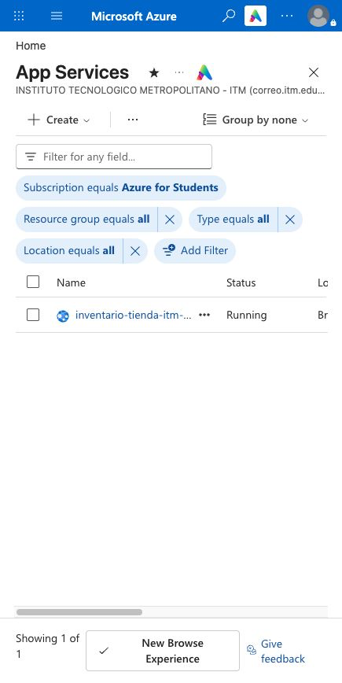
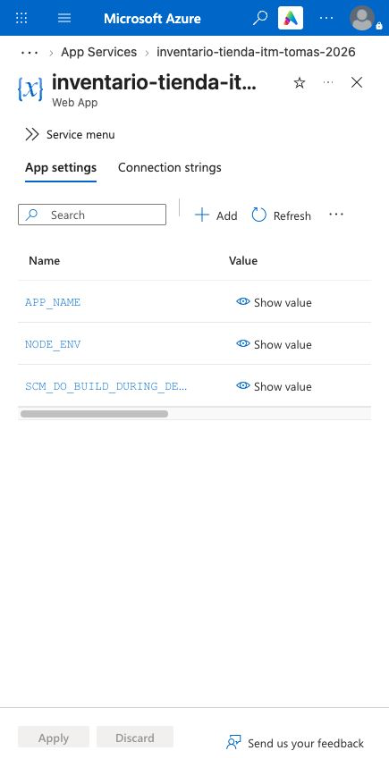
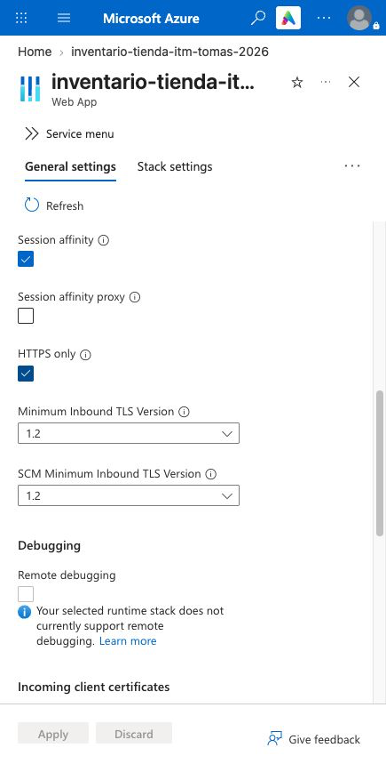
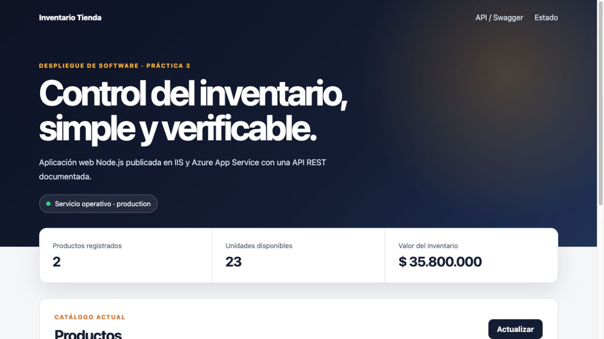
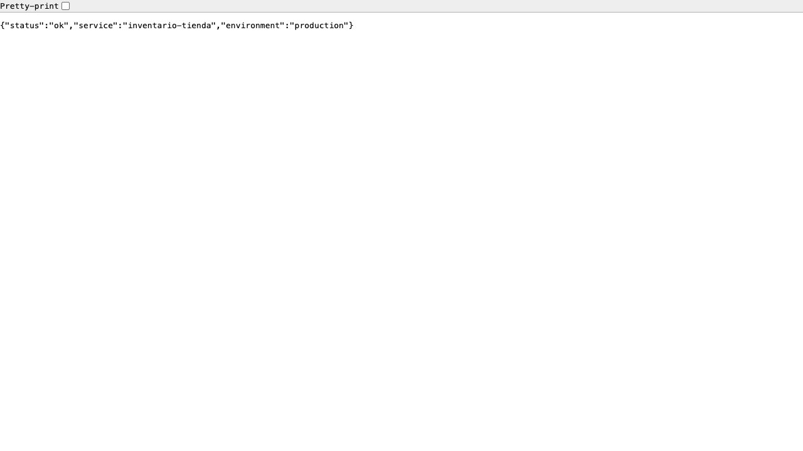

# Publicación en Azure App Service

## Estado actual

La aplicación se encuentra publicada y operativa en Azure App Service.

- Aplicación: `inventario-tienda-itm-tomas-2026`.
- Resource Group: `rg-inventario-tienda-p3`.
- App Service Plan: `asp-inventario-tienda-p3`.
- Región: `Brazil South`.
- SKU: `F1 - Free`.
- Sistema: Linux.
- Runtime: Node.js 24 LTS.
- URL: <https://inventario-tienda-itm-tomas-2026.azurewebsites.net>.
- Health: <https://inventario-tienda-itm-tomas-2026.azurewebsites.net/health>.

## Configuración aplicada

Application Settings:

- `NODE_ENV=production`.
- `APP_NAME=Inventario Tienda`.
- `SCM_DO_BUILD_DURING_DEPLOYMENT=true`.

La opción HTTPS Only está habilitada. Las solicitudes HTTP son redirigidas a HTTPS.

## Resultado de la validación

| Verificación | Resultado |
|---|---|
| Página principal | HTTP 200 |
| Contenido del panel | Correcto |
| `/health` | HTTP 200, estado `ok` |
| `/docs` | HTTP 200 |
| `/api/products` | HTTP 200, dos productos iniciales |
| Redirección HTTP a HTTPS | HTTP 301 |
| Estado del Web App | Running |

## Repetir el despliegue

La cuenta responsable debe iniciar sesión de manera interactiva. No se comparten contraseñas, tokens ni códigos de autenticación.

```powershell
az login
.\scripts\deploy-azure.ps1 -AppName "inventario-tienda-itm-tomas-2026"
```

El script detecta el runtime compatible, crea o reutiliza los recursos, configura las variables, habilita HTTPS Only, genera el paquete ZIP y publica la aplicación.

## Evidencias de Carla Giraldo

Las capturas se guardan en `evidencias/azure/` y documentan la configuración y validación de la publicación:

### Resumen del App Service

La vista general permite comprobar el nombre de la aplicación, su estado y la URL pública.



### Application Settings

La configuración contiene las variables requeridas por la aplicación. La evidencia muestra únicamente los nombres y evita exponer secretos.



### HTTPS Only

El App Service obliga el uso de HTTPS para proteger el tráfico entre el cliente y la aplicación.



### Aplicación pública

El panel de inventario responde correctamente desde la URL pública y reporta el entorno `production`.



### Health check público

El endpoint `/health` devuelve el estado `ok`, el nombre del servicio y el entorno `production`.



Estas evidencias y esta documentación conforman la contribución individual de Carla. Su publicación se realizará posteriormente desde su cuenta de GitHub mediante una rama y un Pull Request, después de revisar el borrador.
